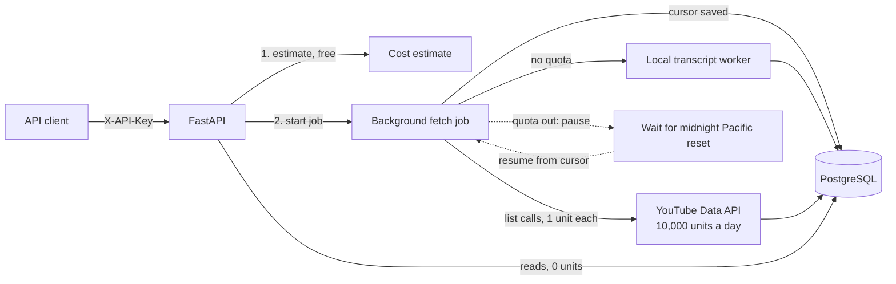

# Channel Analyzer API

A local, quota-aware backend that collects a channel's full public record from the YouTube Data API (channel, videos, comments with replies, playlists, transcripts) into PostgreSQL, so it can be read and analysed repeatedly at zero quota cost.

## How it works

The YouTube Data API gives each Google Cloud project 10,000 units a day. More cannot be bought, and splitting work across projects breaks the API policies. The whole design follows from that budget: fetch each piece of data once, store it, and never spend quota on reads.



### Where the quota goes

| Call | Cost | Use |
|---|---|---|
| `playlistItems.list` + `videos.list` | 2 units per 50 videos | A channel's videos with statistics |
| `commentThreads.list` | 1 unit per page of up to 100 threads | Comments with replies |
| `search.list` | 100 units per page | Finding comparable channels only, never listing a channel's own videos |
| Transcripts | 0 units | Caption data, not the Data API |
| Reading stored data | 0 units | Every read comes from PostgreSQL |

A channel with 1,000 videos costs about 40 units for the videos and about 1,000 more for the top 100 comments on each video. Comments are where the budget goes, so each job chooses a comment mode (`skip`, `top_100` or `all`).

### Design rules

- **Estimate first.** `POST /fetch-jobs/estimate` returns the quota range before a job spends anything.
- **Pause and resume.** Every unit is recorded in a quota ledger (`GET /quota`), with 200 units held back as a safety margin. When the day's quota runs out, the job saves its cursor, pauses, and resumes after the midnight Pacific reset without fetching a page twice.
- **One job at a time**, so two jobs never race for the same budget.
- **Transcripts run locally.** They cost no quota but are blocked from cloud IPs, so the worker runs on the local machine.
- **Truthful data.** Shorts is a labelled heuristic (up to 180 seconds), and hidden counts stay empty, never 0.

## Stack

- Python 3.12, FastAPI, uv (`pyproject.toml` + `uv.lock`)
- PostgreSQL 17 through Prisma Client Python (`prisma-client-py`, asyncio interface)
- Docker Compose for local development (services `api` and `postgres`)
- ruff (lint and format), pytest

Local development only. There is no deployment for now.

## Run

### Prerequisites

- Docker with the Compose plugin (`docker compose version` should work)
- Git
- Optional, only for running Prisma, ruff or pytest on the host: [uv](https://docs.astral.sh/uv/) (it installs Python 3.12 itself)

### First time setup

1. Clone the repository into the group folder, so the database folder ends up next to it:

   ```bash
   cd ~/"projects/projects/youtube channel analyzer"
   git clone https://github.com/yasirkhan54/channel-analyzer-api.git
   cd channel-analyzer-api
   ```

2. Create `.env` from the example:

   ```bash
   cp .env.example .env
   ```

3. Set `CLIENT_API_KEY` in `.env`. The quickest way is the one-line command in [Generate CLIENT_API_KEY](#generate-client_api_key), which creates a key and writes it into `.env` for you.

4. Set `YOUTUBE_API_KEY` in `.env` to a **YouTube Data API v3** key if you want to fetch channels from YouTube. See [Get a YouTube Data API v3 key](#get-a-youtube-data-api-v3-key) for the steps. Without it the app starts and reads stored data, but fetch, search and refresh endpoints fail.

5. Build and start both containers:

   ```bash
   docker compose up -d --build
   ```

   The first start pulls `postgres:17`, builds the API image and applies all migrations.

6. Check that it is up:

   ```bash
   curl http://localhost:8000/health
   # {"status":"ok","database":"ok"}
   ```

7. Open the API docs at http://localhost:8000/api-docs, click **Authorize**, paste your `CLIENT_API_KEY` and try the endpoints.

### Everyday commands

Run these from the `channel-analyzer-api` folder:

| Task | Command |
|---|---|
| Start | `docker compose up -d` |
| Start after changing `Dockerfile`, `pyproject.toml` or `uv.lock` | `docker compose up -d --build` |
| Stop (keeps the data) | `docker compose down` |
| Status | `docker compose ps` |
| API logs | `docker compose logs -f api` |
| Restart the API only | `docker compose restart api` |
| Shell inside the API container | `docker compose exec api sh` |

Code edits reload the server automatically; no restart needed. After changing `.env`, run `docker compose up -d` again so the container picks up the new values.

After a computer restart, Postgres comes back on its own (`restart: unless-stopped`) but the API does not, so run `docker compose up -d` again.

### Troubleshooting

- **`/health` returns 503**: Postgres is not reachable. Check `docker compose ps` and `docker compose logs postgres`.
- **Port 8000 or 5433 already in use**: find what is using it with `ss -ltnp | grep -E ':8000|:5433'` and stop it, or change the host port in `docker-compose.yml`.
- **401 on every endpoint**: the `X-API-Key` header is missing or does not match `CLIENT_API_KEY` in `.env`.
- **API container exits on start**: run `docker compose logs api`; it is usually a failed migration or an empty required variable in `.env`.

### Addresses

- Home page: http://localhost:8000/ (public; live status, quota reset countdown and the route list)
- API docs (Swagger UI): http://localhost:8000/api-docs
- Health: http://localhost:8000/health (returns 200 with `"database": "ok"` when Postgres is reachable, 503 otherwise)
- Postgres on the host: `localhost:5433` (database `youtube_channel_analyzer`, user and password `postgres` unless `POSTGRES_*` is set in `.env`)
- Containers: `channel-analyzer-api` and `channel-analyzer-postgres`, on the `channel-analyzer-network` network

The `api` container runs `prisma migrate deploy` on start, then uvicorn with `--reload`; the code is mounted, so edits reload the server. Database data is kept in the `channel-analyzer-database` folder next to this repository, in the group folder (outside git). `docker compose down` keeps it; to start from an empty database, stop the containers and delete that folder (it is owned by the container's Postgres user, so use `sudo`).

## Client key

Every endpoint except the home page (`/`), `/health` and the API docs requires the static client key in the `X-API-Key` header:

```bash
curl -H "X-API-Key: $CLIENT_API_KEY" http://localhost:8000/channels
```

### Generate CLIENT_API_KEY

The key is any long random string that you make yourself; there is no account or service behind it. Use at least 32 random bytes.

**Option 1: create a key and write it into `.env` in one step** (run from the repository folder, after `cp .env.example .env`):

```bash
KEY=$(python3 -c "import secrets; print(secrets.token_urlsafe(32))") \
  && sed -i.bak "s|^CLIENT_API_KEY=.*|CLIENT_API_KEY=$KEY|" .env \
  && rm .env.bak && unset KEY
```

The key never appears on screen. `sed -i.bak` works on both Linux and macOS.

**Option 2: print a key and paste it into `.env` yourself.** Any one of these works:

```bash
python3 -c "import secrets; print(secrets.token_urlsafe(32))"   # Python 3
openssl rand -hex 32                                             # OpenSSL
```

```powershell
[Convert]::ToHexString([Security.Cryptography.RandomNumberGenerator]::GetBytes(32))   # Windows PowerShell 7
```

Then set the line in `.env`:

```
CLIENT_API_KEY=<the value you generated>
```

**After setting or changing the key:**

1. Run `docker compose up -d` so the `api` container reads the new value.
2. Read it back without printing it elsewhere: `grep '^CLIENT_API_KEY=' .env`.
3. In the API docs, click **Authorize** and paste it; with curl, send it in the `X-API-Key` header as shown above.

Rotating the key: generate a new one the same way, restart with `docker compose up -d`, and update every script or client that calls the API. The old key stops working at once.

## Get a YouTube Data API v3 key

`YOUTUBE_API_KEY` must be a key for the **YouTube Data API v3**, created in a Google Cloud project where that API is enabled. A key from a project without the API enabled is rejected with `403 accessNotConfigured`. It is an API key, not OAuth: no consent screen or sign-in is needed, because the service only reads public data.

1. Open the [Google Cloud Console](https://console.cloud.google.com/) and create a project (or select one).
2. Go to **APIs & Services**, then **Library**, search for **YouTube Data API v3** and click **Enable**.
3. Go to **APIs & Services**, then **Credentials**, click **Create credentials** and choose **API key**.
4. Restrict the key: open it, under **API restrictions** choose **Restrict key** and tick only **YouTube Data API v3**, then **Save**. This way a leaked key cannot be used for any other Google API.
5. Put it in `.env`:

   ```
   YOUTUBE_API_KEY=<your YouTube Data API v3 key>
   ```

6. Run `docker compose up -d` so the `api` container reads it.

To check it works, resolve any public channel once (costs 1 unit):

```bash
curl -X POST http://localhost:8000/channels/resolve \
  -H "X-API-Key: $CLIENT_API_KEY" -H "Content-Type: application/json" \
  -d '{"input": "@YouTube"}'
```

Quota facts for this key:

- It is free and gives **10,000 units a day** per Google Cloud project. Usage shows under **APIs & Services**, **YouTube Data API v3**, **Quotas**.
- The quota resets at midnight Pacific time. This service tracks every unit in its own quota ledger (`GET /quota`) and pauses jobs before the limit.
- More quota cannot be bought; it is only granted through Google's YouTube API Services audit. Spreading work across several projects to get more quota is against the API policies.

## Environment variables

| Variable | Required | Description |
|---|---|---|
| `DATABASE_URL` | Yes | Postgres connection string. The value in `.env` is for running Prisma from the host (`localhost:5433`); Docker Compose sets its own value for the `api` container. |
| `YOUTUBE_API_KEY` | For fetching | YouTube Data API v3 key (an API key from a Google Cloud project with the YouTube Data API v3 enabled). Server side only; sent in the `X-Goog-Api-Key` header, never logged or returned. |
| `CLIENT_API_KEY` | Yes | Static key callers send in `X-API-Key`. |
| `TRANSCRIPT_PROXY_URL` | No | Residential proxy for transcript requests. Not needed when running locally; kept for a future server. |
| `POSTGRES_USER`, `POSTGRES_PASSWORD`, `POSTGRES_DB` | No | Override the Compose Postgres defaults (`postgres`, `postgres`, `youtube_channel_analyzer`). |

Never commit `.env`.

## Database and migrations

The schema is `prisma/schema.prisma`; migrations are in `prisma/migrations/`.

```bash
uv sync                                       # install dependencies on the host
docker compose up -d postgres                 # start only Postgres
uv run prisma migrate dev --name <change>     # create and apply a migration after editing the schema
uv run prisma generate                        # regenerate the client (migrate dev also does this)
```

Applied migrations run automatically when the `api` container starts (`prisma migrate deploy`).

Note: `prisma-client-py` is a community project whose maintainer has announced the end of active maintenance. This risk was accepted when the stack was chosen.

## Lint and test

```bash
uv run ruff check .
uv run ruff format .
uv run pytest
```

Or inside the container: `docker compose exec api pytest`.

## Folder structure

```
controllers/        request handlers
services/           business logic and database access
routes/             FastAPI routers
middleware/         client key middleware
models/             domain models
validators/         Pydantic request and response schemas
configurations/     settings (pydantic-settings) and the Prisma client
utilities/          helpers
constants/          constants
type_definitions/   shared type definitions (named this way because a `types` package would shadow the Python standard library module)
tests/              pytest tests
public/             static files
prisma/             schema.prisma and migrations/
application.py      FastAPI entrypoint
```

## License

MIT, see [LICENSE](LICENSE).

This project uses the YouTube Data API. It is not affiliated with, endorsed or sponsored by YouTube or Google.
